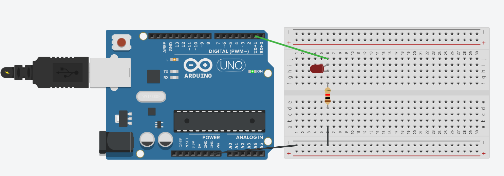

# 02 Flashing the Heater LED

In the SunbYte project, we use resistive heaters to keep spacecraft components from freezing in the extreme cold of near-space. For this workshop, we will use a **Red LED** to represent our heater. When the LED is on, the "heater" is active!

Here is the list of components you need:
* Arduino Uno
* Breadboard
* USB cable
* 1x Red LED
* 1x Resistor
* Jumper wires

## Building the Circuit

1. **Connect Ground:** Run a black wire from one of the Arduino's `GND` pins to the negative (`-`) rail on your breadboard.
2. **Place the LED:** Insert the LED into the breadboard. Note that the longer leg is positive (anode) and the shorter leg is negative (cathode).
3. **Add the Resistor:** Connect the resistor from the LED's short leg (negative) to the ground rail (`-`). This prevents the LED from burning out by limiting the electrical current.
4. **Connect the Signal:** Run a wire (e.g., green) from Arduino Digital Pin `4` to the row containing the LED's long leg (positive).

*(Refer to the diagram below to check your wiring)*  


## Writing the Code

Open the **Arduino IDE** on your laptop. Every Arduino program has two main parts:
* `setup()`: Runs exactly once when the Arduino turns on. We use this to configure our pins.
* `loop()`: Runs continuously forever. We use this to turn the LED on and off.

Copy the following code into your Arduino IDE. **You will need to fill in the blanks (`___`) for the code to compile and work!**

```cpp
// 02: Flashing the Heater LED

// Let's tell the Arduino which pin our LED is connected to!
// Replace the ___ with the digital pin number you used (e.g., 4).
int heaterLED = ___; 

void setup() {
  // We need to tell the Arduino that our LED pin will send power OUT.
  // Hint: Use the word OUTPUT.
  pinMode(heaterLED, _______); 
}

void loop() {
  // 1. Turn the LED ON. 
  // In Arduino, 'HIGH' means sending power (turning it on).
  digitalWrite(heaterLED, ____); 
  
  // 2. Keep it on for 1 second.
  // The delay() function uses milliseconds. (1000 milliseconds = 1 second).
  delay(____); 
  
  // 3. Turn the LED OFF.
  // In Arduino, 'LOW' means stopping the power.
  digitalWrite(_______, LOW); 
  
  // 4. Wait for another second while it is off before the loop repeats.
  delay(____); 
}
