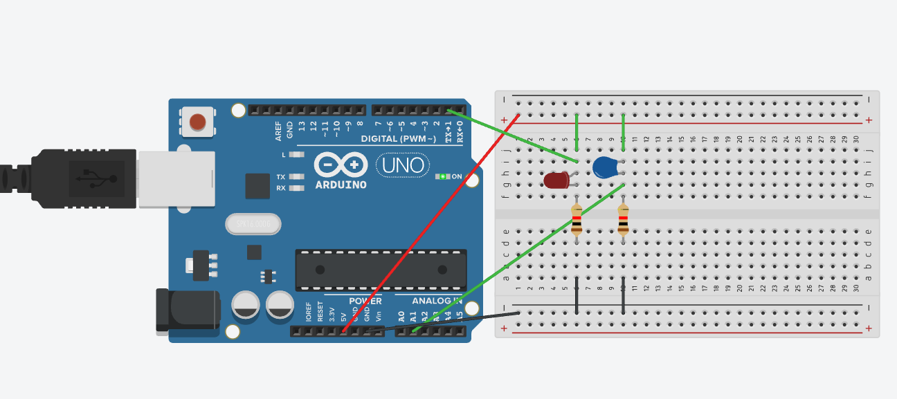

# 03 Building the Thermistor Circuit

In space, temperatures can fluctuate by hundreds of degrees[cite: 16]. To prevent our spacecraft from freezing, we need a way to measure the temperature so we know when to turn our "heater" (the LED) on. 

We will do this using a **Thermistor**—a special type of resistor that changes its resistance based on how hot or cold it is. 

However, an Arduino cannot measure resistance directly; it can only measure *voltage*. To fix this, we will build a **Voltage Divider** by combining the thermistor with a standard 10kΩ fixed resistor[cite: 16].

## Building the Circuit

Keep your LED wired exactly as it was in the previous step. Now, let's add the sensor:

1. **Provide Power (5V):** Run a wire (e.g., red) from the Arduino's `5V` pin to the positive (`+`) rail on your breadboard.
2. **Place the Thermistor:** Plug one leg of the blue thermistor into the 5V `+` rail, and the other leg into a new row on the breadboard (e.g., row 10).
3. **Add the 10kΩ Resistor (Voltage Divider):** Connect the fixed 10kΩ resistor from the thermistor's row (row 10), across the middle gap of the breadboard, and into a new hole on the other side.
4. **Connect to Ground:** Run a black wire from the end of the 10kΩ resistor to the ground (`-`) rail.
5. **Connect the Signal:** Run a wire (e.g., green) from Arduino Analog Pin `A0` to the middle connection point between the thermistor and the 10kΩ resistor (e.g., row 10).

*(Refer to the updated diagram below to check your wiring)*


## Writing the Code

Instead of digital signals (`HIGH`/`LOW`), we will use **analog** signals to read a range of values from our sensor[cite: 16]. 

Open your Arduino IDE and update your code. We are introducing `Serial.begin(9600)` so the Arduino can talk to your laptop, and `analogRead()` to measure the voltage. 

**Fill in the blanks (`___`) to complete the code:**

```cpp
// 03: Reading the Thermistor

// Define our pins
int heaterLED = 4; 
int thermistorPin = A0; 

// A variable to store the temperature data
int thermistorValue = 0; 

void setup() {
  pinMode(heaterLED, OUTPUT);
  
  // Start the serial connection so the Arduino can send data to the laptop
  Serial.begin(9600); 
}

void loop() {
  // Read the analog voltage from the sensor (values range from 0 to 1023)
  thermistorValue = analogRead(__________); 

  // Print the value to the computer
  Serial.println(_____________); 
  
  // A small delay to stop the data from scrolling too fast
  delay(100); 
}
